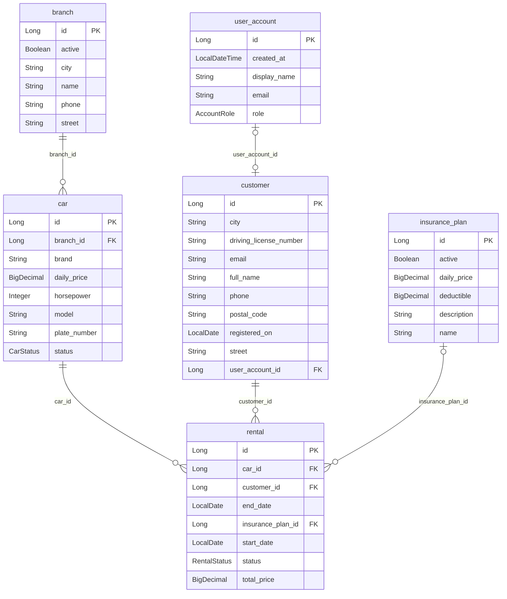

# Schemat bazy danych

Plik generują reguły projektu (panel Maven → Lifecycle → verify). Nie edytujcie go ręcznie.

Tabele: 6 · kolumny: 43 · relacje: 4 × @ManyToOne, 1 × @OneToMany, 1 × @OneToOne, 0 × @ManyToMany

| Tabela | Encja | Kolumny | Klucze obce |
|---|---|---|---|
| branch | Branch | 6 | — |
| car | Car | 8 | branch_id |
| customer | Customer | 10 | user_account_id |
| insurance_plan | InsurancePlan | 6 | — |
| rental | Rental | 8 | car_id, customer_id, insurance_plan_id |
| user_account | UserAccount | 5 | — |

